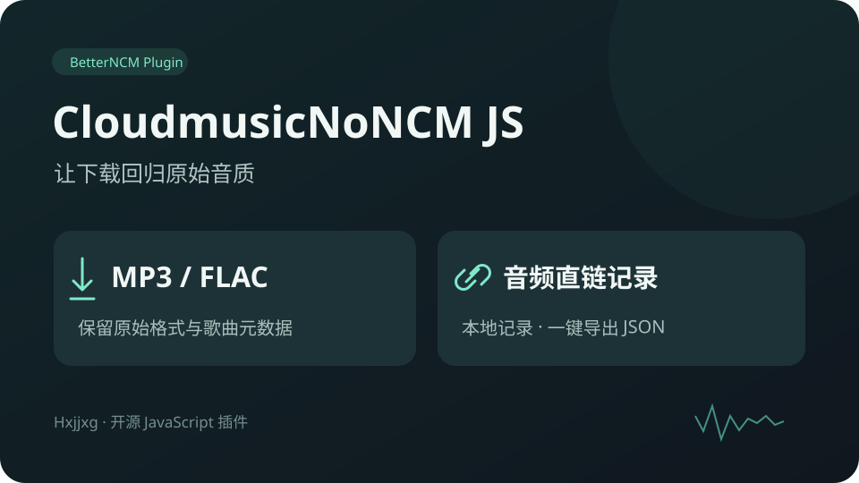

# CloudmusicNoNCM JS

BetterNCM / Chromatic 插件，保留新下载歌曲的 MP3、FLAC 格式，支持下载链接记录和 JSON 导出。

已验证：Windows 网易云音乐 **3.1.5.203580**、**3.1.43.205627**，BetterNCM **1.3.4**。声明兼容范围为 3.1.5–3.1.43，范围内其他版本尚未逐一实测。



## 安装

运行 `npm run pack`，将生成的 `dist/*.plugin` 放入 BetterNCM 数据目录的 `plugins` 文件夹，重载页面。

开发时，将本项目的 `plugin` 文件夹复制到以下位置：

```text
<BetterNCM 数据目录>/plugins_dev/cloudmusic-no-ncm-js/
  manifest.json
  hook.js
  main.js
  preview.svg
```

打包版与开发版选一种安装。

## 使用

插件设置提供格式保留、链接记录开关，以及记录导出和清空功能。默认启用两个开关。

记录保存在当前页面内存中，最多 200 条，重载后清空。导出文件保存到 BetterNCM 数据目录；链接可能过期。

插件保留封面和歌曲元数据，不改变下载音质或下载权限，不转换已有的 NCM 文件。

## CDP 临时注入

需要 Node.js 22+，以及已启用远程调试的客户端，默认端口为 9222。

```powershell
node scripts/cdp.mjs install
node scripts/cdp.mjs status
node scripts/cdp.mjs export
node scripts/cdp.mjs disable
node scripts/cdp.mjs enable
node scripts/cdp.mjs uninstall
```

默认导出到 `captures/download-records.json`。`export <文件路径>` 可指定位置。设置环境变量 `CDP_URL` 可更改调试地址，`CDP_TARGET` 可指定 `list` 命令列出的页面 ID 前缀。临时注入在页面重载后失效。

## 实现

包装 `window.channel.call`，处理歌曲的 `storage.addid3` 调用：

```js
ext.encrypt = false;
ext.media_rel_path = /* 原输出路径，后缀替换为源文件的 .mp3 或 .flac */;
```

仅处理原本加密且输出为 `.ncm` 的 MP3/FLAC 歌曲请求。未知参数、解密请求和其他格式直接放行。复制参数后修改，保留原回调、调用上下文和返回值。

链接记录来自 `download.start`，包含音频 URL、歌曲任务 ID、路径、大小和 MD5。插件不上传记录。

## 开发

无需安装 npm 依赖。打包需要 PowerShell。

```powershell
npm run check
npm test
npm run pack
```

12 项自动化测试覆盖参数处理、桥接语义、记录、生命周期、卸载共存和设置页链接。已完成 VIP 无损歌曲的实际下载验证，输出文件头及 STREAMINFO 确认为 FLAC；未进行整首解码校验。

3.1.43.205627 上已分别验证 VIP 歌曲的 320 kbps MP3 和无损 FLAC 下载，链接记录、加密参数修改及客户端下载完成状态均正常。

## 源码与反馈

[源代码](https://github.com/Hxjjxg/cloudmusic-no-ncm-hook) · [问题反馈](https://github.com/Hxjjxg/cloudmusic-no-ncm-hook/issues)

思路参考 [Dir-A/CloudmusicNoNCM](https://github.com/Dir-A/CloudmusicNoNCM)。本项目使用独立的 JavaScript 桥接实现，以 GPL-3.0-only 许可证开源，见 [LICENSE](LICENSE)。
